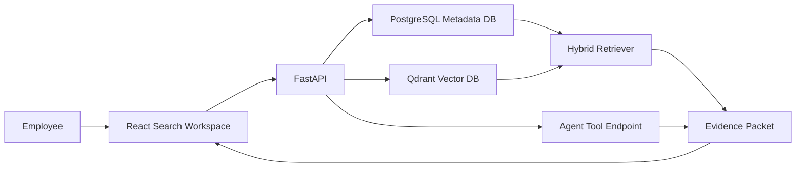

# LocalLens AX 업그레이드 PRD

## 1. 문서 목적

이 문서는 기존 `LocalLens`를 사내 문서 탐색 AX 시나리오에 맞게 확장하기 위한 제품 요구사항 문서다.

기존 `LocalLens`는 선택한 로컬 폴더의 텍스트, 이미지, PDF를 색인하고 자연어로 검색하는 local-first multimodal retrieval engine이다.

업그레이드 버전인 `LocalLens AX`는 임직원이 흩어진 사내 문서를 파일명이나 폴더 위치가 아니라 문서 내용, 의미, 권한 기준으로 찾을 수 있게 하는 AX 문서 검색 시스템을 목표로 한다.

## 2. 핵심 결론

기존 구조는 개인 로컬 검색에 적합하다.

AX 버전은 문서 메타데이터, 권한, 검색 로그, 색인 상태, Agent tool 연결이 필요하므로 서비스형 구조로 확장한다.

추천 기술 방향은 다음과 같다.

| 계층 | 선택 | 역할 |
|---|---|---|
| Frontend | React | 임직원 문서 검색 UI |
| Backend API | FastAPI | 문서 업로드, 색인, 검색, 피드백 API |
| Metadata DB | PostgreSQL | 문서, 권한, 색인 상태, 검색 로그 관리 |
| Vector DB | Qdrant | 문서 chunk embedding 검색 |
| Retrieval | Hybrid Retrieval | keyword search와 semantic search 결합 |
| Agent 확장 | Document Search Tool | Agent가 사내 문서 근거를 조회하는 tool |

## 3. Problem

회사 내부 문서는 PDF, 이미지, 텍스트, 보고서, 매뉴얼, 회의록 등 다양한 형식으로 흩어져 있다.

기존 파일명 검색이나 폴더 탐색은 다음 문제가 있다.

| 문제 | 설명 |
|---|---|
| 파일명 의존 | 문서 제목을 정확히 모르면 찾기 어렵다 |
| 내용 검색 한계 | PDF 내부 텍스트, 이미지 설명, 표 내용을 함께 찾기 어렵다 |
| 권한 문제 | 사내 문서는 사용자, 부서, 문서 등급별 접근 제어가 필요하다 |
| 검색 근거 부족 | 왜 이 문서가 검색됐는지 snippet, page, chunk 근거가 필요하다 |
| Agent 연결 한계 | Agent가 문서 근거 없이 일반 답변을 생성하면 업무 신뢰도가 낮다 |

## 4. Goals

| 목표 | 설명 |
|---|---|
| G1. 사내 문서 검색 AX화 | 임직원이 자연어로 필요한 사내 문서를 찾을 수 있게 한다 |
| G2. 문서 메타데이터와 벡터 검색 분리 | PostgreSQL과 Qdrant의 역할을 명확히 분리한다 |
| G3. Hybrid Retrieval 구현 | 키워드 검색과 의미 검색을 함께 사용한다 |
| G4. 권한 필터 기반 검색 | 사용자에게 허용된 문서만 결과로 반환한다 |
| G5. 근거 표시 | 검색 결과에 문서, 페이지, chunk, snippet을 포함한다 |
| G6. Agent Tool 확장 | 문서 검색 기능을 Agent가 호출 가능한 tool로 제공한다 |
| G7. 평가 가능성 확보 | fixture 기반 recall, MRR, latency, 권한 누출 테스트를 준비한다 |

## 5. Non-Goals

이번 업그레이드에서 하지 않는 것:

| 제외 항목 | 이유 |
|---|---|
| 실제 기업 배포 claim | 현재 목표는 포트폴리오/시연용 AX 시나리오 구현이다 |
| 실사용 사내 데이터 사용 | PII, 사내 기밀, 저작권 이슈를 피한다 |
| production 운영 성공 claim | 운영 환경 검증 전에는 주장하지 않는다 |
| 완전한 권한 보장 claim | fixture 기준 권한 필터 테스트로 제한한다 |
| 모든 문서 형식 완전 지원 | PDF, 이미지, 텍스트 중심으로 제한한다 |
| LLM 답변 품질 보장 | Agent tool은 우선 evidence packet 반환까지로 제한한다 |

## 6. Target Users

| 사용자 | 필요 |
|---|---|
| 일반 임직원 | 문서명 없이 자연어로 필요한 자료 검색 |
| 팀 리더 | 팀/부서 문서 빠른 탐색 |
| 사내 지식 관리자 | 문서 색인 상태와 검색 로그 확인 |
| AI Agent | 업무 질문에 필요한 문서 근거 조회 |

## 7. 핵심 제품 시나리오

### Scenario 1. 임직원 자연어 문서 검색

사용자는 “휴가 신청 절차 알려줘”처럼 자연어로 검색한다.

시스템은 문서 제목뿐 아니라 PDF 본문, chunk, 이미지 caption을 대상으로 관련 문서를 찾고, 문서명, 페이지, snippet, 근거 chunk를 반환한다.

### Scenario 2. 권한 기반 검색

사용자는 본인 부서와 권한에 맞는 문서만 볼 수 있다.

검색 단계에서 Qdrant payload filter를 적용하고, 결과 반환 전 PostgreSQL access policy로 재검증한다.

### Scenario 3. Agent 문서 검색 Tool

Agent는 사용자의 질문에 직접 답변하기 전에 `search_documents` tool을 호출한다.

Tool은 답변이 아니라 문서 근거 묶음을 반환한다.

답변 생성 계층은 반환된 근거만 사용해 응답을 구성한다.

## 8. Target Architecture



## 9. Data Model 초안

### PostgreSQL

| 테이블 | 목적 |
|---|---|
| `users` | 임직원 사용자 |
| `departments` | 부서/조직 |
| `documents` | 문서 기본 정보 |
| `document_versions` | 문서 버전 |
| `document_chunks` | 검색 단위 chunk |
| `access_policies` | 문서 접근 정책 |
| `indexing_jobs` | 색인 작업 상태 |
| `search_logs` | 검색 질의 로그 |
| `feedback` | 검색 결과 피드백 |

### Qdrant Payload

```json
{
  "document_id": "doc_001",
  "chunk_id": "chunk_001_003",
  "version_id": "v1",
  "page": 3,
  "modality": "pdf_text",
  "department_id": "hr",
  "acl_tags": ["hr", "all_employee"],
  "title": "휴가 신청 가이드",
  "snippet": "연차 신청은 사내 포털에서..."
}
```

## 10. Retrieval Design

검색은 세 단계로 구성한다.

| 단계 | 설명 |
|---|---|
| Keyword Search | PostgreSQL full-text search로 정확 키워드 검색 |
| Semantic Search | Qdrant embedding search로 의미 기반 검색 |
| Fusion | RRF 또는 가중 합산으로 최종 순위 생성 |

권한 처리는 두 번 수행한다.

| 위치 | 목적 |
|---|---|
| Qdrant payload filter | 검색 후보 단계에서 권한 범위 축소 |
| PostgreSQL access policy check | 최종 반환 전 권한 재검증 |

## 11. API Requirements

| Method | Endpoint | 목적 |
|---|---|---|
| `POST` | `/api/v1/documents` | 문서 등록 |
| `GET` | `/api/v1/documents` | 문서 목록 조회 |
| `GET` | `/api/v1/documents/{document_id}` | 문서 상세 조회 |
| `POST` | `/api/v1/indexing/jobs` | 색인 작업 생성 |
| `GET` | `/api/v1/indexing/jobs/{job_id}` | 색인 상태 조회 |
| `GET` | `/api/v1/search` | 자연어 문서 검색 |
| `POST` | `/api/v1/search/feedback` | 검색 결과 피드백 |
| `POST` | `/api/v1/agent/tools/document-search` | Agent용 문서 검색 tool |

API 응답은 내부 오류를 노출하지 않는다.

검색 응답에는 최소한 다음 필드를 포함한다.

```json
{
  "query": "휴가 신청 절차",
  "results": [
    {
      "document_id": "doc_001",
      "chunk_id": "chunk_001_003",
      "title": "휴가 신청 가이드",
      "page": 3,
      "snippet": "연차 신청은 사내 포털에서...",
      "modality": "pdf_text",
      "score": 0.87,
      "source_ref": "doc_001#page=3&chunk=003"
    }
  ]
}
```

## 12. Frontend Requirements

React UI는 다음 화면을 제공한다.

| 화면 | 목적 |
|---|---|
| 검색 홈 | 자연어 검색 입력 |
| 검색 결과 | snippet, page, source_ref 표시 |
| 문서 상세 | 문서 metadata, chunk preview |
| 색인 상태 | indexing job 진행 상태 |
| 관리자 요약 | 색인 통계, 검색 로그 요약 |

초기 버전에서는 인증 UI를 복잡하게 만들지 않는다.

fixture 사용자 기반 role selector로 시연한다.

## 13. Agent Tool Requirements

Tool 이름:

```text
search_documents
```

입력:

```json
{
  "query": "휴가 신청 절차",
  "top_k": 5,
  "filters": {
    "department_id": "hr",
    "document_type": "pdf"
  }
}
```

출력:

```json
{
  "evidence_packets": [
    {
      "document_id": "doc_001",
      "chunk_id": "chunk_001_003",
      "title": "휴가 신청 가이드",
      "snippet": "연차 신청은 사내 포털에서...",
      "source_ref": "doc_001#page=3&chunk=003"
    }
  ]
}
```

Agent tool은 답변을 생성하지 않는다.

Agent tool은 근거 검색 결과만 반환한다.

## 14. Evaluation Requirements

| 평가 | 기준 |
|---|---|
| Retrieval Quality | recall@5, MRR@10, nDCG@10 |
| Latency | search latency p50, p95 |
| Permission Boundary | 권한 없는 문서가 결과에 나오지 않음 |
| Sync | 신규/수정/삭제 문서 색인 상태 반영 |
| Evidence Quality | 결과에 snippet, page, chunk_id 포함 |
| Agent Tool Contract | tool output schema 유지 |

테스트 데이터는 fixture/sample corpus로 제한한다.

실사용 전체 정확도나 production 성능을 주장하지 않는다.

## 15. Claim Boundary

### 이력서/포트폴리오에 안전한 표현

```text
사내 문서 탐색 AX 시나리오를 기준으로 설계
PostgreSQL metadata와 Qdrant vector store 역할 분리
권한 필터를 고려한 hybrid retrieval 구조 설계
문서 검색 API를 Agent tool로 확장 가능한 구조 구성
fixture 기준 검색 품질과 권한 경계 테스트 설계
```

### 피해야 할 표현

```text
사내 도입 완료
production 운영 성공
모든 문서 검색 정확도 보장
권한 누출 완전 방지
실사용 임직원 검증 완료
기업 문서 전체 자동 이해
```

## 16. Implementation Units

| id | depends_on | scope | acceptance_tests | risk_level | rollback_plan |
|---|---|---|---|---|---|
| AX-001 | 없음 | AX PRD, ADR, claim boundary 문서화 | 문서에 scope, non-goals, claim boundary 포함 | 낮음 | 문서 삭제 |
| AX-002 | AX-001 | PostgreSQL schema 초안 추가 | migration/schema 파일 존재, 테이블 정의 확인 | 중간 | schema 변경 revert |
| AX-003 | AX-002 | Qdrant payload schema 정리 | payload에 document_id, chunk_id, acl_tags 포함 | 중간 | 기존 QdrantStore adapter 유지 |
| AX-004 | AX-002, AX-003 | FastAPI 검색 API 추가 | `/api/v1/search` fixture 응답 확인 | 중간 | API module 제거 |
| AX-005 | AX-004 | Hybrid retrieval 추가 | keyword/semantic 결과 normalize, fusion 결과 반환 | 높음 | semantic-only fallback |
| AX-006 | AX-004 | React 검색 UI 추가 | 검색 입력, 결과 목록, snippet 표시 | 중간 | UI route 제거 |
| AX-007 | AX-005 | Agent tool endpoint 추가 | evidence packet schema 반환 | 중간 | tool endpoint 비활성화 |
| AX-008 | AX-005, AX-007 | 평가 fixture 추가 | recall/permission/tool schema 테스트 정의 | 중간 | fixture/eval module 제거 |

## 17. Phased Plan

### Phase 1. 구조 고정

문서, ADR, DB/VDB 역할, claim boundary를 먼저 고정한다.

### Phase 2. Retrieval Backend

PostgreSQL metadata schema와 Qdrant payload schema를 연결한다.

### Phase 3. API Service

FastAPI 기반 문서 검색 API와 indexing job API를 추가한다.

### Phase 4. Hybrid Search

keyword search와 semantic search를 결합하고 권한 필터를 적용한다.

### Phase 5. AX UI

React 기반 검색 화면과 결과 근거 표시 UI를 만든다.

### Phase 6. Agent Tool

검색 API를 Agent가 호출 가능한 document search tool로 노출한다.

### Phase 7. Evaluation

fixture 기준 retrieval 품질, 권한 경계, tool contract 평가를 추가한다.

## 18. Open Decisions

| 결정 | 기본안 |
|---|---|
| PostgreSQL 실행 방식 | local Docker 또는 embedded dev profile |
| Qdrant 실행 방식 | 기존 local mode 유지, server mode는 선택 |
| React 위치 | `frontend/` 신규 생성 |
| FastAPI 위치 | `locallens/api/` 신규 생성 |
| 인증 구현 | 초기에는 fixture user context |
| Agent framework | 초기에는 framework 독립 tool endpoint |

## 19. 최종 포지셔닝

`LocalLens AX`는 기존 개인 로컬 파일 검색기를 사내 문서 탐색 AX 시나리오로 확장한 프로젝트다.

핵심은 기술 스택 교체가 아니다.

핵심은 다음 구조적 전환이다.

```text
파일 검색 앱
-> 문서 metadata 관리
-> 권한 기반 retrieval
-> hybrid search
-> evidence packet
-> Agent tool 연결
```

