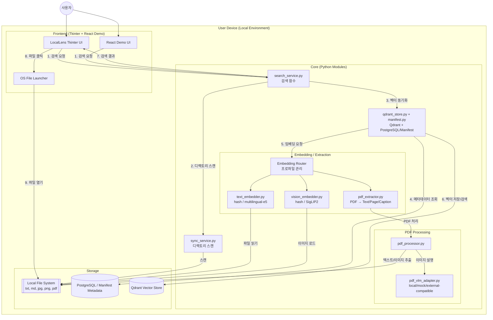
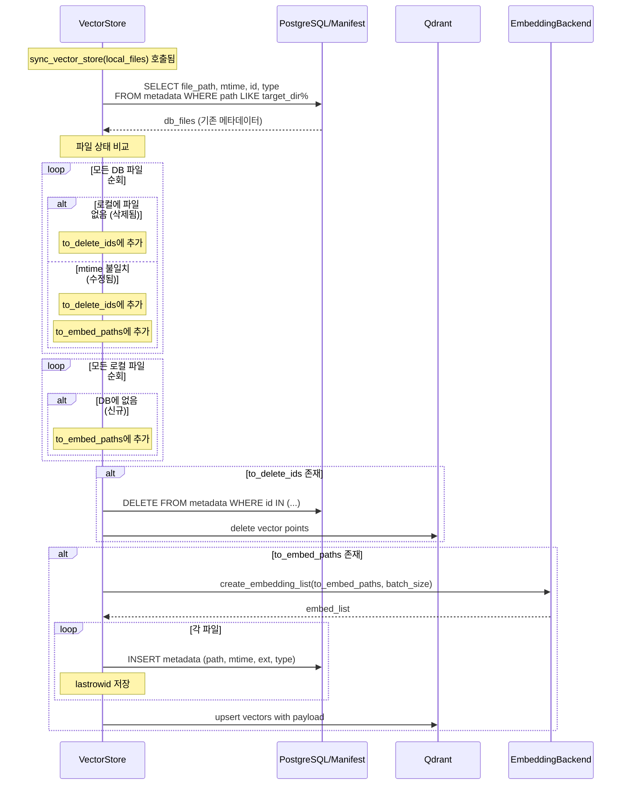
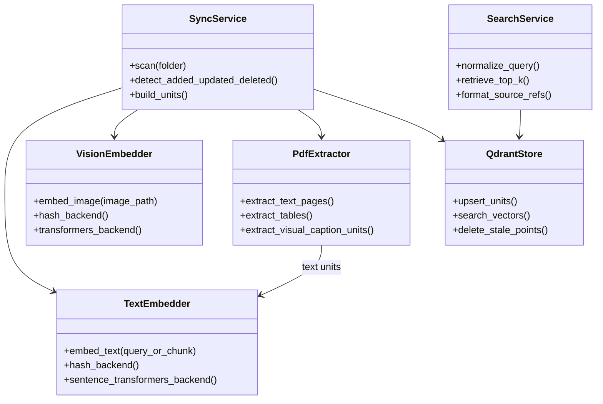

## 🔎 LocalLens: 로컬 우선 멀티모달 파일 검색 서비스

> 텍스트·이미지·PDF를 로컬에서 인덱싱하고 자연어로 검색하는 멀티모달 Retrieval 서비스

## 👀 프로젝트 소개

<b>LocalLens</b>는 로컬 환경의 텍스트, 이미지, PDF 데이터를 통합 관리하고 자연어 쿼리로 검색할 수 있는 프라이버시 중심의 <b>멀티모달 지능형 검색 서비스</b>입니다.
고성능 멀티모달 모델을 활용하여 사용자의 로컬 환경 내에 존재하는 이종 데이터 간의 <b>의미론적 연결을 파악</b>하고 통합 검색을 수행하는 엔진을 구축하는 것을 목표로 합니다. <br>특히 클라우드 기반이 아닌 <b>로컬 환경</b>에서의 구동을 지향하여, 개인의 민감한 사진이나 기업의 대외비 문서 등 프라이버시가 중요한 데이터에 대해 외부 유출 없는 안전한 인덱싱 및 검색 환경을 제공하고자 합니다.

## ⏲ 프로젝트 진행

◼ 개발 환경

> <b>하드웨어 및 서버:</b> 로컬 Windows 개발 환경, Docker 기반 PostgreSQL/Qdrant 검증 환경 <br>
> <b>개발 언어 및 프레임워크:</b> Python, PyTorch, Hugging Face Transformers, Python Tkinter, FastAPI, React <br>
> <b>검색 및 저장소:</b> Qdrant, PostgreSQL, local manifest, hybrid retrieval <br>
> <b>데이터 처리:</b> PyMuPDF, pdfplumber, Tesseract(opt-in), VLM provider adapter <br>
> <b>검증 및 기록:</b> pytest, Docker Compose, PowerShell smoke script, ADR, test evidence

## 🛠 기술 스택 (Tech Stack)

|           구분           | 상세 기술                                              | 비고                                |
| :----------------------: | :----------------------------------------------------- | :---------------------------------- |
|         **언어**         | Python 3.10+                                           | 메인 언어                           |
|      **AI / Core**       | PyTorch, Hugging Face Transformers                     | 임베딩 모델 추론                    |
|    **텍스트 임베딩**     | `intfloat/multilingual-e5-small`                       | 다국어 텍스트 임베딩                |
|    **이미지 임베딩**     | `google/siglip2-so400m-patch16-naflex`                 | 이미지-텍스트 멀티모달              |
|       **PDF 처리**       | PyMuPDF, pdfplumber, Tesseract(opt-in)                 | PDF 텍스트/표/이미지 추출           |
|         **VLM**          | external VLM-compatible adapter / local VLM / mock VLM | PDF 내 이미지 설명 생성             |
| **벡터 DB / 메타데이터** | Qdrant + PostgreSQL + local manifest                   | 벡터 저장 및 메타데이터 관리        |
|      **GUI / Demo**      | Tkinter + FastAPI + React                              | 데스크톱 클라이언트 및 로컬 데모 UI |
|      **설정 관리**       | 환경 변수 + CLI 옵션                                   | 로컬 실행 및 provider 모드 제어     |
|      **로컬 검증**       | Docker Compose, pytest, PowerShell smoke script        | PostgreSQL/Qdrant 및 demo E2E 검증  |

## ⚙ 시스템 구조 및 주요 기능

### ◼ 전체 구조도



### ◼ 주요 기능 <br>

1️⃣<b>자연어 쿼리 기반 멀티모달 검색:</b> 사용자가 "강아지가 뛰어노는 사진"이나 "회의록 요약"과 같은 자연어 문장을 입력하면, 텍스트 파일뿐만 아니라 이미지, PDF 문서 등 다양한 포맷의 파일 중 의미적으로 가장 유사한 결과를 검색합니다.<br><br>
2️⃣<b>로컬 벡터 DB 및 파일 동기화 시스템:</b> 로컬 파일 시스템을 스캔하여 변경(신규, 수정, 삭제)된 파일만을 감지하고, 이를 벡터화하여 자체 구축한 로컬 벡터 DB(Vector Store)에 저장 및 관리합니다. <br><br>
3️⃣<b>로컬 UI 및 데모 제공:</b> Python Tkinter 기반 데스크톱 UI와 FastAPI/React 기반 로컬 데모 UI를 제공하여 검색 결과와 evidence packet 흐름을 확인할 수 있습니다.

### ◼ 주요 구현 알고리즘 및 기술

### <b> 🔄 File Sync Logic (파일 동기화 및 필터링)</b>

로컬 검색 엔진의 핵심은 파일 시스템의 상태와 DB의 상태를 일치시키는 것입니다. 이를 위해 다음과 같은 지능형 동기화 로직을 구현하여 임베딩 연산 자원을 최적화하였습니다.

| 단계       | 프로세스              | 상세 설명                                                                        |
| :--------- | :-------------------- | :------------------------------------------------------------------------------- |
| **Scan**   | **전수 조사**         | 지정된 루트 경로 하위의 모든 파일 리스트를 스캔하여 현재 상태를 파악합니다.      |
| **Filter** | **Ghost 감지**        | DB에는 존재하지만 실제 폴더에는 없는 파일(삭제된 파일)을 찾아 DB에서 제거합니다. |
| **Filter** | **New/Modified 감지** | 파일의 수정 날짜(mtime)를 DB 메타데이터와 비교하여 신규/수정 파일만 추출합니다.  |
| **Sync**   | **선택적 임베딩**     | 변경된 파일(`Embedding Target`)만 인코더로 전달하여 벡터 DB를 업데이트합니다.    |
| **Skip**   | **연산 생략**         | 변경 없는(`Unchanged`) 파일은 임베딩 과정을 생략하여 컴퓨팅 자원을 보존합니다.   |

> **💡 Insight:** 이 로직을 통해 수천 개의 파일 중 변경된 데이터만 선별 처리함으로써, 불필요한 재인덱싱 시간을 방지하고 로컬 환경에서의 구동 효율을 극대화했습니다.

### <b>🗃️ VectorStore (벡터 저장소)</b>

VectorStore는 **Qdrant**와 **PostgreSQL/Manifest 메타데이터**를 결합하여 벡터 임베딩과 파일 메타데이터를 통합 관리하는 핵심 컴포넌트입니다.

| 구성 요소                 | 역할                                                                            |
| :------------------------ | :------------------------------------------------------------------------------ |
| **Qdrant Vector Store**   | 타입별(image, text, docs) 벡터 저장 및 코사인 유사도 기반 검색 수행             |
| **PostgreSQL / Manifest** | 파일 경로, 수정 시간(mtime), 확장자, 타입, workspace 메타데이터 저장            |
| **동기화 로직**           | 로컬 파일과 DB 상태를 비교하여 신규/수정/삭제 파일을 감지하고 선택적으로 임베딩 |
| **검색**                  | 쿼리 벡터와 인덱스 벡터 간 코사인 유사도 계산 후 Top-K 결과 반환                |

#### VectorStore 동기화 상세



<br>

### <b>🧠 멀티모달 임베딩 (Multimodal Embedding)</b>



| 핵심 기술                 | 상세 내용                                                                                                                                                                          |
| :------------------------ | :--------------------------------------------------------------------------------------------------------------------------------------------------------------------------------- |
| **Vision-Text Alignment** | 이미지와 텍스트를 동일한 벡터 공간에 매핑하기 위해 사전 학습된 **CLIP** 계열의 모델을 활용하였습니다.                                                                              |
| **Query Process**         | 사용자의 자연어 쿼리 또한 동일한 텍스트 인코더를 통해 벡터화됩니다. 인덱싱된 이미지/문서 벡터와 쿼리 벡터 간의 <b>코사인 유사도</b>를 계산하여 가장 연관성 높은 결과를 반환합니다. |
| **Cross-Modal Retrieval** | 텍스트로 이미지를 찾는 것뿐만 아니라, 이미지 쿼리로 유사 이미지를 찾거나 관련 문서를 탐색하는 교차 모달리티 검색을 지원합니다.                                                     |

> **🚀 Technical Value:** 각기 다른 형태의 데이터를 하나의 <b>의미 단위</b>로 통합 관리함으로써, 파일 형식에 구애받지 않는 지능형 통합 검색 환경을 구축했습니다.

## 📂 프로젝트 구조

```
📦LocalLens
 ┣ 📂locallens                 # 애플리케이션 핵심 로직
 ┃ ┣ 📂api                     # FastAPI 기반 로컬 데모 API
 ┃ ┣ 📂app                     # CLI / 앱 실행 엔트리 포인트
 ┃ ┣ 📂ax                      # AX workspace 확장, 권한/근거 패킷 흐름
 ┃ ┣ 📂embeddings              # 텍스트/이미지 임베딩 백엔드
 ┃ ┣ 📂extractors              # 텍스트, 이미지, PDF 추출기
 ┃ ┣ 📂indexing                # 파일 동기화 및 인덱싱 파이프라인
 ┃ ┣ 📂retrieval               # 검색, 랭킹, 결과 정규화
 ┃ ┗ 📂ui                      # Tkinter UI adapter
 ┣ 📂frontend                  # React 기반 로컬 데모 UI
 ┣ 📂sql                       # PostgreSQL schema / seed
 ┣ 📂scripts                   # 로컬 smoke / release 검증 스크립트
 ┣ 📂docs                      # ADR, evidence, runbook
 ┣ 📂tests                     # 단위 테스트 및 파이프라인 검증 코드
 ┣ 📂benchmarks                # fixture, benchmark, demo dataset
 ┣ 📜docker-compose.ax.yml     # PostgreSQL/Qdrant 로컬 검증 환경
 ┣ 📜pyproject.toml            # 프로젝트 의존성 및 패키지 설정
 ┗ 📜README.md                 # 프로젝트 설명 문서
```

## 🔢 데이터 흐름 (Data Flow)

| 단계 | 컴포넌트               | 설명                                         |
| :--: | :--------------------- | :------------------------------------------- |
|  1   | UI/API → SearchService | 사용자 쿼리, 대상 디렉토리, 확장자 필터 전달 |
|  2   | SyncService            | 지정 디렉토리에서 확장자별 파일 목록 스캔    |
|  3   | Manifest/QdrantStore   | 로컬 파일과 메타데이터 상태 비교 및 동기화   |
|  4   | Embedding Backend      | 신규/수정된 파일의 임베딩 생성               |
|  5   | QdrantStore            | Qdrant 인덱스에서 유사도 검색 수행           |
|  6   | Result Formatter       | 결과를 타입별로 정렬하고 source_ref 구성     |

## 🤖 사용 모델

|   타입    | 모델                                                         | 용도                                          |
| :-------: | :----------------------------------------------------------- | :-------------------------------------------- |
| **Text**  | hash backend / `intfloat/multilingual-e5-small` opt-in       | 텍스트 파일/쿼리 임베딩                       |
| **Image** | hash backend / `google/siglip2-so400m-patch16-naflex` opt-in | 이미지/이미지 검색 쿼리 임베딩                |
|  **PDF**  | PDF extractor + VLM provider adapter                         | PDF 텍스트 추출 + 이미지 설명 → 텍스트 임베딩 |
|  **VLM**  | external VLM-compatible adapter / local VLM / mock VLM       | PDF 내 이미지/표/그래프 설명 생성             |

### 지원 파일 형식

|  타입  | 확장자                  | 임베딩 모델                 |
| :----: | :---------------------- | :-------------------------- |
| 텍스트 | `.txt`, `.md`           | multilingual-e5-small       |
| 이미지 | `.jpg`, `.jpeg`, `.png` | SIGLIP2                     |
|  문서  | `.pdf`                  | multilingual-e5-small + VLM |

## 📥 설치 및 실행

### 요구사항

- Python 3.10+
- CUDA 지원 GPU (권장, CPU도 가능)

### 설치

```bash
# 저장소 클론
git clone https://github.com/figure-2/LocalLens.git
cd LocalLens

# 의존성 설치
pip install -e .
```

### 실행

```bash
python -m locallens.app.main
```

또는

```bash
python -m locallens.app.cli search "검색어"
```

> **참고:** 기본 로컬 검색은 외부 API 없이 동작합니다. external VLM-compatible 경로는 명시적으로 credentials를 설정한 경우에만 사용합니다.

### 로컬 데모 실행

FastAPI와 React 데모 UI를 함께 실행할 수 있습니다.

```bash
python -m uvicorn locallens.api.main:app --host 127.0.0.1 --port 8021
cd frontend
npm install
npm run dev -- --host 127.0.0.1 --port 5178
```

브라우저에서 `http://127.0.0.1:5178/?api=http%3A%2F%2F127.0.0.1%3A8021`로 접속합니다.

## ⚙ 설정

기본 로컬 검색은 외부 API 없이 동작하며, 환경 변수와 CLI 옵션으로 데이터 경로, 모델, VLM provider를 조정할 수 있습니다.

```powershell
$env:LOCALLENS_DATA_DIR=".locallens\portfolio-demo"
$env:LOCALLENS_PDF_VLM_MODE="off"          # off | mock-vlm | local-vlm | clova-studio
$env:LOCALLENS_TEXT_EMBEDDING_BACKEND="hash"
$env:LOCALLENS_VISION_EMBEDDING_BACKEND="hash"
```

## 📋 사용 방법

1. **폴더 선택**: "파일찾기" 버튼으로 검색 대상 폴더의 절대경로를 선택합니다.
2. **파일 타입 선택**: 좌측 체크박스에서 검색할 파일 형식(이미지, 텍스트, PDF)을 선택합니다.
3. **검색어 입력**: 자연어로 검색어를 입력합니다. (예: "강아지가 뛰어노는 사진")
4. **Top K 조절**: 원하는 검색 결과 개수를 설정합니다.
5. **검색 실행**: 검색 버튼 클릭 시 진행 상황이 바 형태로 표시됩니다.
6. **결과 확인**: 유사도 점수와 함께 파일 타입별로 결과가 표시됩니다.
7. **파일 열기**: 결과에서 파일 경로를 클릭하면 해당 파일이 바로 열립니다.

## ✨ 최종 결과

1️⃣ 검색할 로컬 폴더를 지정해 텍스트, 이미지, PDF 파일을 인덱싱합니다.<br>
2️⃣ 자연어 검색어를 입력해 파일명뿐 아니라 파일 내부 내용과 이미지 설명을 기준으로 검색합니다.<br>
3️⃣ 신규/수정/삭제 파일만 감지해 전체 재임베딩 비용을 줄입니다.<br>
4️⃣ Qdrant와 PostgreSQL/manifest를 분리해 벡터 검색과 메타데이터 관리를 나눕니다.<br>
5️⃣ 검색 결과를 Agent가 사용할 수 있는 evidence packet 형태로 정규화합니다.<br>
