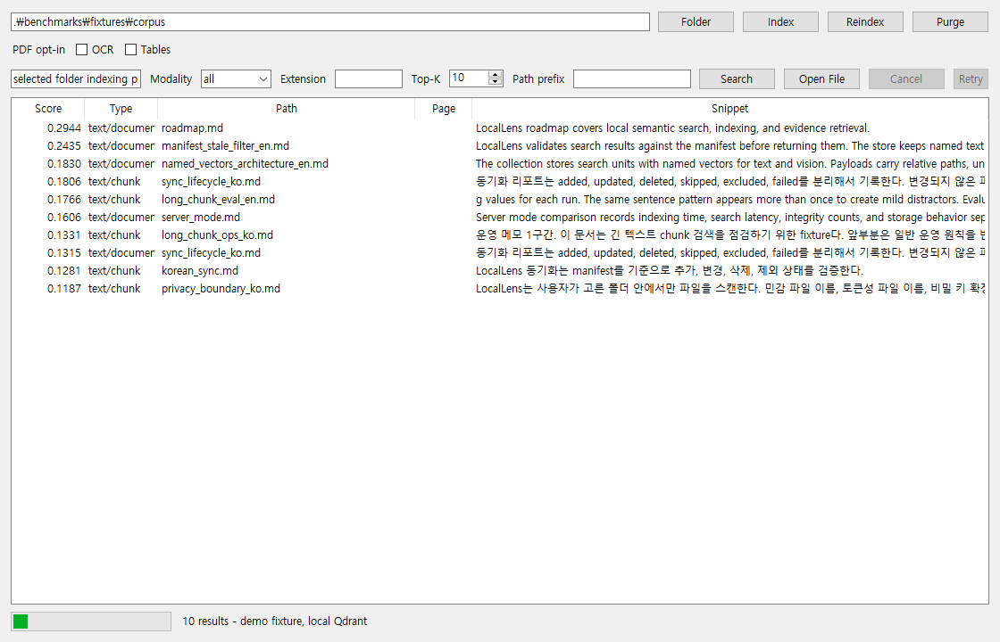

# LocalLens Portfolio Demo Runbook

This runbook is the public, reproducible demo path for LocalLens. It uses only
tracked sanitized fixtures and the default hash backend, so it does not require
API keys, external model downloads, or private cache paths.

## 1. Environment

```powershell
conda create -n locallens python=3.11 -y
conda activate locallens
python -m pip install -e ".[dev]"
python -m pytest -q
```

Use a dedicated local data directory for demo runs:

```powershell
$env:LOCALLENS_DATA_DIR=".locallens\portfolio-demo"
```

The `.locallens` directory is ignored by git and stores local Qdrant data,
manifest state, and generated demo reports.

## 2. CLI Demo

Use the tracked text fixture corpus:

```powershell
python -m locallens.app.cli scan .\benchmarks\fixtures\corpus
python -m locallens.app.cli index .\benchmarks\fixtures\corpus
python -m locallens.app.cli search "selected folder indexing privacy"
python -m locallens.app.cli benchmark .\benchmarks\fixtures\corpus --golden .\benchmarks\fixtures\golden_queries.json --out .locallens\portfolio_demo_benchmark.json
```

Expected smoke scope:

| Check | Expected |
| --- | --- |
| scanned fixture files | 22 |
| indexed units | 46 |
| default text profile | `hash:64` |
| benchmark queries | 12 |
| benchmark output | `.locallens\portfolio_demo_benchmark.json` |

Run these commands sequentially in Qdrant local mode. If two commands open the
same local Qdrant folder at once, Qdrant can reject the second process with a
local storage lock. Use Qdrant server mode for concurrent access.

## 3. GUI Demo

Start the desktop adapter:

```powershell
python -m locallens.app.main
```

Demo flow:

1. Choose `benchmarks\fixtures\corpus` as the folder.
2. Leave OCR, table, and VLM options off for the baseline demo.
3. Click `Index`.
4. Search for `selected folder indexing privacy`.
5. Confirm results show relative paths, snippets, unit type, scores, and no
   absolute source path.
6. Capture screenshots of folder selection, completed indexing, search
   results, and cancel/retry controls.

Do not capture private model cache paths, local user directories, API keys,
or raw private evidence paths.

Sanitized screenshot:



## 4. Optional PDF/OCR/Table Demo

The PDF fixture corpus is available at `benchmarks\fixtures\pdf_corpus`.
OCR/table modes are explicit opt-in features and must not be described as
default behavior.

Born-digital table smoke:

```powershell
$env:LOCALLENS_PDF_TABLE_MODE="local-table"
python -m locallens.app.cli benchmark .\benchmarks\fixtures\pdf_corpus --golden .\benchmarks\fixtures\golden_pdf_table_queries.json --out .locallens\portfolio_pdf_table_demo.json
$env:LOCALLENS_PDF_TABLE_MODE=""
```

Local OCR smoke requires a local Tesseract command:

```powershell
$env:LOCALLENS_PDF_OCR_MODE="local-ocr"
$env:LOCALLENS_TESSERACT_CMD="<local-tesseract-command>"
$env:LOCALLENS_TESSERACT_PSM="6"
python -m locallens.app.cli benchmark .\benchmarks\fixtures\pdf_corpus --golden .\benchmarks\fixtures\golden_pdf_ocr_queries.json --out .locallens\portfolio_pdf_ocr_demo.json
$env:LOCALLENS_PDF_OCR_MODE=""
```

## 5. Local VLM Boundary

Local VLM captioning is default-off and remains experimental. Current public
claims must not say that LocalLens has replaced Clova VLM with a local VLM.
Private evidence shows local VLM candidates can create `pdf_visual_caption`
units, but the measured retrieval quality did not clear the promotion bar.

## 6. Release Checks

Before any public release or tag push:

```powershell
python -m locallens.app.cli check-evidence-consistency --claims-file release_evidence_claims.json
python -m locallens.app.cli scan-artifacts --publication-scan --manifest publication_artifacts.txt --manifest generated_evidence_artifacts.txt --blocked-terms-file .locallens\publication-terms.txt
python -m locallens.app.cli scan-artifacts --manifest repo_hygiene_artifacts.txt --blocked-terms-file .locallens\publication-terms.txt
python -m locallens.app.cli release-gate --blocked-terms-file .locallens\publication-terms.txt
```

If `git_history_scan` fails, keep the release blocked until the operator
chooses a remediation strategy. Do not rewrite history or force-push without
explicit approval.

Official references for history remediation:

- [GitHub Docs: Removing sensitive data from a repository](https://docs.github.com/en/authentication/keeping-your-account-and-data-secure/removing-sensitive-data-from-a-repository)
- [Git documentation: git-filter-branch](https://git-scm.com/docs/git-filter-branch)

GitHub recommends understanding rewrite side effects first: changed commit
hashes, coordination with collaborators, force-push implications, and possible
recontamination from old clones. For this project, the safe default is to keep
the public release blocked unless a sanitized public history or controlled
rewrite is explicitly approved.
